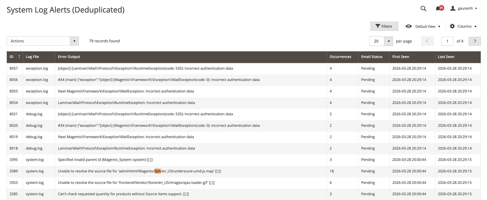
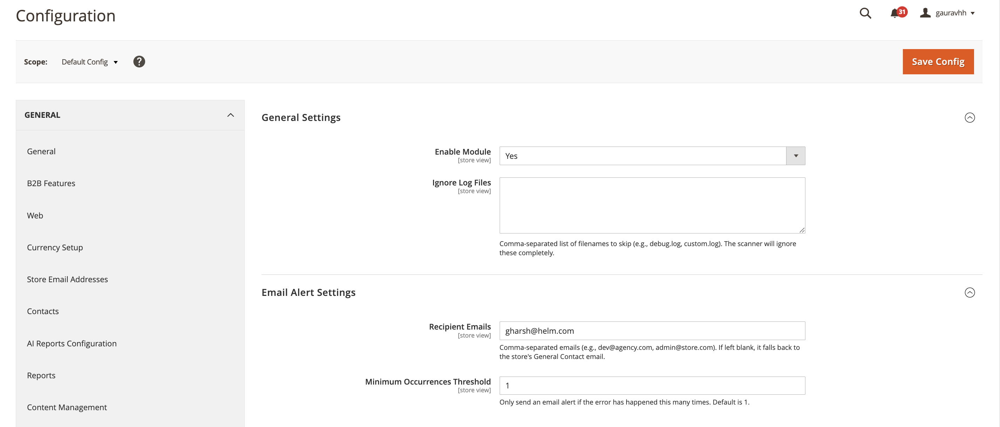

# Gaurav Log Monitor for Magento 2

A professional-grade, high-performance monitoring engine that transforms chaotic `var/log` files into a clean, actionable health dashboard for Adobe Commerce.

## 📖 Why This Module?

In most Magento environments, log files are a "dark hole." They grow to gigabytes, are rarely checked until a site crashes, and contain thousands of repetitive lines that bury the actual root cause of issues.

**Gaurav_LogMonitor** was built to solve this by providing:
* **Proactive Health Checks:** Identifies "Silent Killers" like failed background data syncs (ERP/CRM) that don't crash the frontend.
* **Operational Efficiency:** Stops senior developers from wasting hours "log hunting" through massive text files.
* **Server Stability:** Scans 10GB+ logs using near-zero RAM, ensuring the monitoring tool never becomes a bottleneck.

---

## 🖥️ Preview & UI

### 1. Unified Error Dashboard

*A consolidated, searchable view of all unique errors across every .log file in your system. This grid groups thousands of identical errors into single, manageable records.*

### 2. Smart Alert Configuration

*Easily manage your monitoring settings, define custom email recipients, and set alert thresholds.*

---

## ⚙️ Configuration & Navigation

After installation, you can manage the module and view alerts via the following paths:

### Admin Dashboard (The Grid)
Navigate to: **System > Log Monitor Alerts**
*This is the central command center where you view, filter, and mass-delete deduplicated error logs.*

### System Configuration
Navigate to: **Stores > Configuration > Gaurav Extensions > Log Monitor**
Here you can configure:
* **Enable/Disable:** Master switch for the background scanner.
* **Recipient Emails:** List of developers to receive hourly summaries.
* **Alert Threshold:** Minimum occurrences required before an email is triggered.
* **Ignore List:** Define specific log files (like `debug.log`) to be skipped.

---

## 🏗️ Technical Architecture & Logic Flow

The module follows a highly optimized, four-stage lifecycle:

### 1. High-Performance Scanning Engine
Standard log viewers crash servers by loading entire files into memory. This engine uses **Byte-Offset Tracking**:
* **State Tracking:** Records the exact byte position (`last_byte_offset`) where the last scan ended.
* **Efficient Seek:** Uses PHP’s `fseek()` to jump directly to that byte, reading only **newly appended data**.

### 2. Intelligent Deduplication
Every log line is normalized before storage:
* **Normalization:** Strips timestamps and dynamic variables (IDs, hashes) from log lines.
* **MD5 Hashing:** Generates a unique hash of the core error string.
* **Consolidation:** Matches existing hashes to increment the **occurrence_count** rather than creating duplicates.

### 3. Automated Cron Lifecycle
* **`logmonitor_process` (Every 5 Mins):** The "Watcher" that scans files and populates the dashboard.
* **`logmonitor_send_alerts` (Every Hour):** The "Messenger" that batches new critical errors into a single HTML email.

---

## 🛠️ Installation & Setup

```bash
composer require gauravharsh/module-log-monitor
bin/magento module:enable Gaurav_LogMonitor
bin/magento setup:upgrade
bin/magento setup:di:compile
bin/magento cache:flush